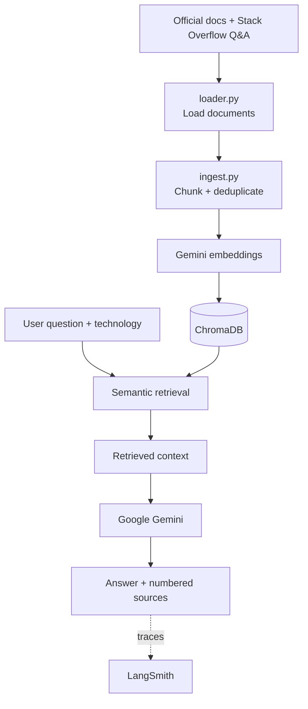

<div align="center">

# 🪛 DebugDesk

**Paste an error. Get a grounded explanation, a suggested fix, and the sources behind it.**

An AI debugging assistant built with Retrieval-Augmented Generation (RAG) over official documentation and Stack Overflow Q&A.


</div>

---

## Table of Contents

- [Overview](#overview)
- [Features](#-features)
- [Architecture](#-architecture)
- [Tech Stack](#-tech-stack)
- [Knowledge Sources](#-knowledge-sources)
- [Quick Start](#-quick-start)
- [Data Collection and Ingestion](#-data-collection-and-ingestion)
- [Running the App](#-running-the-app)
- [Evaluation](#-evaluation)
- [Monitoring with LangSmith](#-monitoring-with-langsmith)
- [Project Structure](#-project-structure)
- [Configuration](#-configuration)
- [Troubleshooting](#-troubleshooting)
- [Security](#-security)
- [Limitations](#-limitations)

---

## Overview

General-purpose chatbots often give confident but unverifiable debugging advice. **DebugDesk** takes a different approach: it first retrieves relevant passages from official documentation and community Q&A stored in a ChromaDB vector database, then asks Google Gemini to explain the error using *only* that retrieved context. Every answer comes with numbered source references, so you can check the claim yourself.

**How a typical session goes:**

1. Pick a technology (or search across all of them).
2. Paste an error message or ask a question.
3. Read the likely cause and suggested fix, with numbered citations.
4. Open the retrieved source documents shown below the answer.

## ✨ Features

- **Technology-aware retrieval:** Choose Python, Java, JavaScript, MySQL, or Streamlit, or search across **All**.
- **Grounded answers:** Passages are retrieved from ChromaDB before generation, so responses are based on indexed sources.
- **Source references:** Retrieved documents are listed with links to the original source where available.
- **Gemini end to end:** Gemini generates answers, and Gemini embeddings power semantic search.
- **Observability:** LangSmith tracks requests; the sidebar shows token usage, estimated cost, LLM latency, and total latency.
- **Built-in evaluation:** A script tests in-context and out-of-context questions and saves the results.
- **Resumable ingestion:** The pipeline chunks, deduplicates, and embeds data incrementally, so it can continue pending chunks across runs.

## 🧭 Architecture



### Retrieval and generation

1. The user selects a technology and enters an error message or question.
2. DebugDesk searches the ChromaDB collection for relevant passages.
3. If a specific technology is selected, a **technology metadata filter** is applied. Selecting **All** searches without it.
4. The retrieved passages are passed to Gemini as context.
5. Gemini explains the likely cause, suggests fixes, and cites sources by number.
6. The retrieved source documents are displayed below the answer.

> **Retrieval setting:** `TOP_K = 5`. The app fetches a larger candidate set, then keeps up to five results with **distinct source values**, which avoids returning several chunks from the same page.

## 🛠️ Tech Stack

| Category | Technology |
|---|---|
| Language | Python |
| Web framework | Streamlit |
| LLM | Google Gemini |
| Embeddings | Gemini embedding model |
| RAG framework | LangChain |
| Vector database | ChromaDB |
| Web scraping | Requests, BeautifulSoup |
| Document processing | PyPDF, LangChain document loaders |
| Monitoring | LangSmith |

## 📚 Knowledge Sources

| Technology | Documentation | Format | Stack Overflow Q&A |
|---|---|---|:---:|
| Python | [Official docs (3.13)](https://docs.python.org/3.13/) | TXT | ✅ |
| JavaScript | [MDN Web Docs](https://developer.mozilla.org/en-US/docs/Web/JavaScript) | Markdown | ✅ |
| Java | [Oracle Java SE 21 docs](https://docs.oracle.com/en/java/javase/21/) | HTML | — |
| MySQL | [MySQL 8.4 Reference Manual](https://dev.mysql.com/doc/refman/8.4/en/) | PDF | — |
| Streamlit | [Official docs](https://docs.streamlit.io/) | Markdown | ✅ |

Stack Overflow data is collected only for Python, JavaScript, and Streamlit, and only for questions with accepted answers.

## 🚀 Quick Start

**Prerequisites:** Python and a [Google Gemini API key](https://aistudio.google.com/app/apikey). A [LangSmith](https://smith.langchain.com/) key is needed only if you want tracing.

```bash
# 1. Clone
git clone https://github.com/premaditya/DebugDesk.git
cd DebugDesk

# 2. Create and activate a virtual environment
python -m venv venv
source venv/bin/activate        # Linux / macOS
venv\Scripts\activate           # Windows

# 3. Install dependencies
pip install -r requirements.txt
```

Create a `.env` file in the project root:

```env
GOOGLE_API_KEY=your_google_gemini_api_key

# LangSmith tracing
LANGCHAIN_TRACING_V2=true
LANGCHAIN_API_KEY=your_langsmith_api_key
LANGCHAIN_PROJECT=debugdesk
```

Then [build the knowledge base](#-data-collection-and-ingestion) and [run the app](#-running-the-app).

## 📥 Data Collection and Ingestion

The `data/` and `chroma_db/` folders are **not** in the repository. You generate them locally.

### Step 1: Collect Stack Overflow data

```bash
python fetch_stackoverflow.py
```

Fetches accepted-answer questions for the configured technologies and saves them as Markdown files.

### Step 2: Add official documentation

Download the documentation sources listed [above](#-knowledge-sources) and place them in the structure configured in `loader.py`:

```text
data/
├── docs/
│   ├── python/
│   ├── javascript/
│   ├── java/
│   ├── MySQL/
│   └── streamlit/
└── issues/
    ├── python/
    ├── javascript/
    ├── java/
    ├── MySQL/
    └── streamlit/
```

### Step 3: Build the vector database

```bash
python ingest.py
```

The pipeline loads documents, splits them into chunks (preserving heading and source metadata), removes duplicates, embeds them with Gemini, and stores them in `chroma_db/`.

Ingestion is **incremental**: if it stops (for example, due to API rate limits), run it again and it continues with the pending chunks.

## ▶️ Running the App

```bash
streamlit run app.py
```

Open the local URL printed in your terminal.

## 🧪 Evaluation

```bash
python evaluation.py
```

The script runs predefined questions:

- **In-context:** questions about the supported technologies, which should be answerable from the index.
- **Out-of-context:** questions unrelated to the knowledge base, which test how the app behaves when retrieval has nothing relevant.

Answers are saved to a timestamped file, `generation_results_YYYYMMDD_HHMMSS.txt`, and a summary is printed with total questions, successful and failed requests, total processing time, and average processing time.

## 📊 Monitoring with LangSmith

With tracing enabled, the Streamlit sidebar shows per-request metrics:

| Metric | Description |
|---|---|
| Input tokens | Tokens sent to the LLM |
| Output tokens | Tokens generated by the LLM |
| Total tokens | Input + output |
| Estimated cost | Estimated LLM usage cost |
| LLM latency | Time spent in the LLM call |
| Total latency | End-to-end request time |

Full traces are available in your LangSmith project (`debugdesk` by default).

## 📂 Project Structure

```text
DebugDesk/
├── app.py                   # Streamlit UI and request flow
├── llm.py                   # Retrieval and Gemini answer generation
├── loader.py                # Loads docs and Q&A from data/
├── ingest.py                # Chunking, deduplication, embedding, ChromaDB storage
├── fetch_stackoverflow.py   # Stack Overflow Q&A collection
├── evaluation.py            # Evaluation script
├── style.css                # UI styling
├── requirements.txt
├── .gitignore
├── data/                    # Local docs and Q&A (generated, git-ignored)
├── chroma_db/               # Local vector database (generated, git-ignored)
└── generation_results_*.txt # Evaluation outputs
```

## ⚙️ Configuration

| Variable | Required | Purpose |
|---|:---:|---|
| `GOOGLE_API_KEY` | Yes | Gemini generation and embeddings |
| `LANGCHAIN_TRACING_V2` | No | Set to `true` to enable LangSmith tracing |
| `LANGCHAIN_API_KEY` | If tracing | LangSmith API key |
| `LANGCHAIN_PROJECT` | No | LangSmith project name (`debugdesk`) |

## 🩹 Troubleshooting

| Problem | Likely fix |
|---|---|
| App starts but answers are empty or irrelevant | The vector database is missing or empty. Run `python ingest.py` first. |
| Authentication or API key errors | Check `GOOGLE_API_KEY` in `.env` and that you run commands from the project root. |
| Ingestion stops partway | Re-run `python ingest.py`; it resumes pending chunks. |
| No metrics in the sidebar | Confirm the LangSmith variables are set and `LANGCHAIN_TRACING_V2=true`. |
| Results look outdated after changing sources or chunking | Rebuild the vector database. |

## 🔐 Security

- API keys live in environment variables.
- `.env` is git-ignored. Never commit it.
- Generated datasets and the vector database are excluded from the repository.

## ⚠️ Limitations

- Answer quality depends on how well the indexed sources cover your problem.
- Retrieval quality depends on chunking, metadata, and embedding quality.
- Java and MySQL are covered by official documentation only, with no community Q&A.
- Rebuild `chroma_db/` after significant changes to sources or chunking settings.
- The vector database must be generated locally before the app can run.

---

<div align="center">

**DebugDesk** — Debug smarter with answers grounded in technical documentation.

</div>